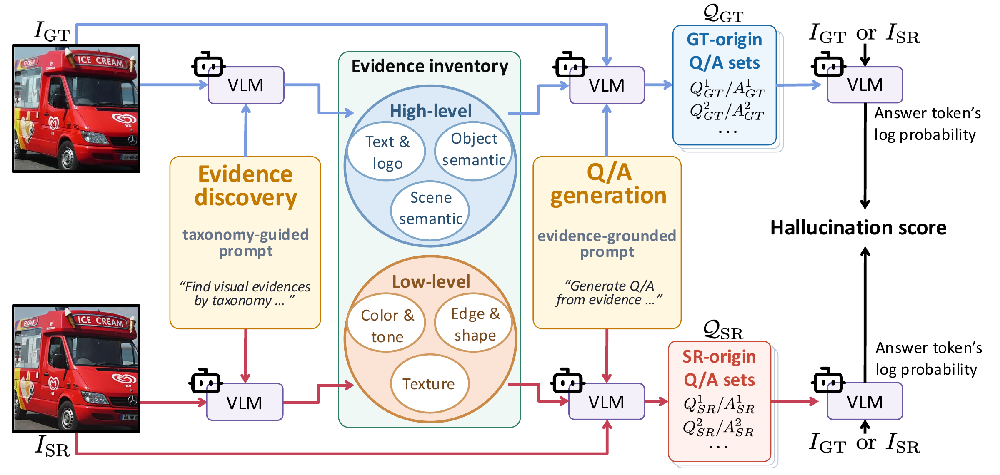

<div align="center">

<h1>VHA: VQA-based Hallucination Assessment for Generative Image Super-Resolution</h1>

<a href="https://arxiv.org/abs/2610.25770"></a>
<a href="https://dhryougit.github.io/Hallucination-Assessment-pages/"></a>

</div>

## 🎬 Overview



**VHA** assesses hallucination using High/Low Q/A. **VHA+** learns an image-based
assessor from VHA scores. Higher scores indicate more hallucination relative to GT.

## 🧑‍🔬 VHA-bench

**VHA-bench** is a human-annotated benchmark for evaluating hallucination in
generative image super-resolution. It includes 90 GT images and 540 SR images
from six methods, with human hallucination scores. Higher scores indicate more
hallucination.

The download contains images, mean human scores (`mos.csv`), and individual
ratings (`ratings.csv`).

Place `images/`, `mos.csv`, and `ratings.csv` under `data/benchmark/`.
Evaluation reads `sample_id,image,method,human_score,n_ratings` from `mos.csv`
and resolves image paths from `image` and `method`. Individual participant
IDs in `ratings.csv` are not used by the evaluation code.

| Dataset | Download |
|---|---|
| VHA-bench | [Google Drive](https://drive.google.com/drive/folders/1TEYDmms1CQNUDWjwVxNcQdwyYXveg32D?usp=drive_link) · [Hugging Face](https://huggingface.co/datasets/dhryou/VHA-bench) |

## 📂 Model checkpoints

| Model | Description | Download |
|---|---|---|
| VHA+ | Lightweight hallucination assessor for GT–SR image pairs. | [Google Drive](https://drive.google.com/file/d/19jOvo8LR7HeXva0y0ub2LY0WxEeabxxI/view?usp=drive_link) · [Hugging Face](https://huggingface.co/dhryou/VHA-plus) |
| Qwen3-VL-8B-Instruct | Required for VHA Q/A generation and hallucination scoring. | [Hugging Face](https://huggingface.co/Qwen/Qwen3-VL-8B-Instruct) |

Download the VHA+ checkpoint and save it as `data/checkpoints/vhaplus.pt`.
Build the VHA+ training data from the source images as shown below.

## 🔧 Installation

Requires Python 3.11 and an NVIDIA GPU with CUDA.

```bash
git clone https://github.com/dhryougit/Hallucination-Assessment.git
cd Hallucination-Assessment
pip install -r requirements.txt
```

## 🧪 Generate Q/A, score, and evaluate VHA

Qwen weights are downloaded automatically on the first run and reused from the
Hugging Face cache afterward. To use a pre-downloaded model, add
`--model /path/to/Qwen3-VL-8B-Instruct`
to Q/A generation, VHA evaluation, or training data construction. Use the same
`--model` value for generation and evaluation.

```bash
# 1. Generate Q/A for GT and SR images
python scripts/vha/qa_generation.py --split gt
python scripts/vha/qa_generation.py --split sr

# 2. Compute VHA scores and evaluate against human scores
python scripts/vha/evaluate.py
```

Q/A generation saves `outputs/vha/{gt_qa,sr_qa}.jsonl`; use `--resume` to continue
an interrupted run. `evaluate.py` reads these files and calls `scoring.py` to
compute VHA scores, then compares them with human scores. Raw Q/A scores, pair
scores, and correlation metrics are saved under `outputs/vha/evaluation/`.

## 🏗️ Construct VHA+ training data

| Resource | Download |
|---|---|
| LSDIR | [Official dataset](https://github.com/ofsoundof/LSDIR) |
| TextVQA | [Official dataset](https://textvqa.org/download/) |
| PiSA-SR weights and code | [Official repository](https://github.com/csslc/PiSA-SR#-quick-inference) |
| Stable Diffusion 2.1 base | [Hugging Face](https://huggingface.co/stabilityai/stable-diffusion-2-1-base) |

Download and extract the source images and models. Install PiSA-SR using its
[official instructions](https://github.com/csslc/PiSA-SR#-dependencies-and-installation).
Use LSDIR train/validation HR images and TextVQA train/test images; no original
TextVQA Q/A annotations are needed. Pass the PiSA environment's Python executable
with `--pisa-python` and the SD model directory in diffusers format with `--sd-path`.

```bash
python scripts/vha+/training_data_construction.py \
  --lsdir-train /path/to/LSDIR/train/HR \
  --lsdir-val /path/to/LSDIR/val/HR \
  --textvqa-train /path/to/TextVQA/train_images \
  --textvqa-val /path/to/TextVQA/test_images \
  --pisa-root /path/to/PiSA-SR \
  --pisa-python /path/to/pisa-env/bin/python \
  --sd-path /path/to/stable-diffusion-2-1-base \
  --checkpoint /path/to/pisa_sr.pkl \
  --output-root data/training
```

The script selects 20K eligible images per dataset for training and up to 250 per
dataset for validation, then creates 512×512 center crops. It generates PiSA-SR
with downscales `{0.5, 0.375, 0.25}`, 1×/2× input upsampling, and pixel/semantic
controls `{(1,0), (0.5,1), (1,1)}`. VHA scores the image pairs to produce training labels.

Images and `manifests/{train_raw.csv,val_raw.csv,raw_manifest_summary.json}` are
saved under `data/training/`, ready for `train.py`. The selected sources and
settings are recorded in `construction_config.json`; intermediate Q/A and raw
scores are saved in `construction.sqlite3`. Add `--resume` after interruption.
Use `--dry-run` to check the inputs without generating data. A new image
selection or regenerated Q/A can produce different labels from the original run.
For another output location, set `TRAINING_ROOT` in `scripts/vha+/dataloader.py`.

## 🚀 Train and evaluate VHA+

```bash
torchrun --standalone --nproc_per_node=1 scripts/vha+/train.py \
  --output-dir outputs/vhaplus

python scripts/vha+/evaluate.py \
  --checkpoint data/checkpoints/vhaplus.pt \
  --output outputs/vhaplus_evaluation
```

Train VHA+ using VHA scores and evaluate it on VHA-bench.
